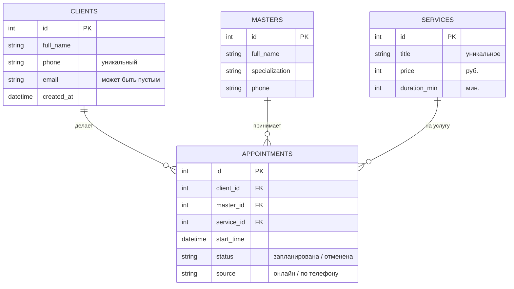

# Онлайн-запись в салон красоты

Лабораторная работа по дисциплине «Командное проектирование и разработка».
Предметная область — автоматизация онлайн-записи в салоне красоты (тема моей ВКР).

Python, SQLAlchemy (ORM), Alembic (миграции), база SQLite.

## Структура проекта

```
app/
  db/            подключение к базе: Base, engine, сессия
  models/        модели: клиент, мастер, услуга, запись
  repositories/  репозитории клиентов и записей
migrations/      миграции Alembic
examples/
  test_repositories.py   проверка методов репозиториев
```

## Схема данных



Клиент может записаться много раз, у мастера много записей, одна услуга встречается во многих записях.
Каждая запись — это один клиент, один мастер и одна услуга на определённое время.

## Репозитории

`ClientRepository` — CRUD для клиентов: добавить, найти по id и по телефону, поиск по имени,
список всех, изменить, удалить, клиент вместе с его записями.

`AppointmentRepository` — записи: создать, записи клиента, расписание мастера на день,
проверка, свободен ли мастер на время услуги, отмена, удаление.

Репозитории не вызывают `commit()`, транзакцией управляет код, который создал сессию.

## Установка

    python3 -m venv .venv
    source .venv/bin/activate        # Windows: .venv\Scripts\activate
    pip install -r requirements.txt

## Миграции

    alembic upgrade head                              # создать / обновить базу
    alembic revision --autogenerate -m "описание"     # новая миграция после изменения моделей
    alembic downgrade -1                              # откатить последнюю

## Проверка

    python -m examples.test_repositories
